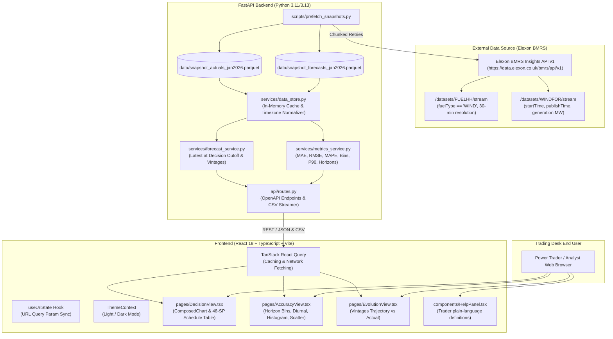

# Wind Forecast Insights

> **Production-grade Day-Ahead Wind Generation Forecasting & Accuracy Analytics for the UK Power Trading Desk.**  
> Powered by live and snapshotted National Grid ESO / Elexon BMRS market data for January 2026.

---

## 1. Project Overview

In the UK power market, the electricity trading desk must bid and procure power on day-ahead power exchanges (EPEX SPOT and Nord Pool) before the gate closure deadline on **$D-1$** (typically locking physical procurement decisions around **09:00 UK local time**). Because wind power is intermittent and zero-marginal-cost, day-ahead power traders must accurately predict wind generation to calculate the net residual demand that must be covered with thermal, storage, and interconnectors.

**Wind Forecast Insights** provides the trading team with:
1. **Decision View**: Select any delivery day ($D$) in January 2026 and decision cutoff time (default: 09:00 UK time on $D-1$). The system automatically resolves the newest available numerical weather prediction published on or before the cutoff, alongside the actual outturn generation and an empirical **P90 uncertainty confidence envelope**.
2. **Forecast Accuracy Analytics**: Quantifies historical model performance across 14,000+ forecast/actual outturn pairings in January 2026. Evaluates MAE, RMSE, zero-guarded MAPE, systematic Mean Bias, error percentiles ($P_{50}, P_{90}, P_{95}, P_{99}$), error degradation by forecast lead time horizon (0h to 48h+), hour-of-day diurnal patterns, error distribution histograms, and scatter parity plots.
3. **Forecast Evolution (Vintages)**: Tracks the chronological evolution of successive model runs for any target half-hour settlement period as the delivery time approached.
4. **Trader Help Panel**: Plain-language explanations of financial and operational implications of errors.
5. **Data Export**: One-click CSV downloads for every view.
6. **URL State Synchronization**: Filters (date, decision time, active tab, target interval) are synchronized with URL query parameters for team bookmarking and sharing.

---

## 2. Architecture Diagram



---

## 3. Directory & File Structure

```
├── backend/
│   ├── app/
│   │   ├── api/
│   │   │   ├── __init__.py
│   │   │   └── routes.py             # FastAPI REST endpoints & streaming CSV exporter
│   │   ├── models/
│   │   │   ├── __init__.py
│   │   │   └── schemas.py            # Pydantic v2 data models for API schemas
│   │   ├── services/
│   │   │   ├── __init__.py
│   │   │   ├── data_store.py         # Thread-safe in-memory cache & parquet/JSON loader
│   │   │   ├── elexon_client.py      # Resilient HTTP client with retries and timeouts
│   │   │   ├── forecast_service.py   # Decision-cutoff filtering and vintage trajectory
│   │   │   └── metrics_service.py    # Error formulas (MAE, RMSE, MAPE, Bias, P90)
│   │   ├── config.py                 # Application settings (timezones, CORS, base URLs)
│   │   └── main.py                   # FastAPI lifespan application entrypoint
│   ├── data/
│   │   ├── snapshot_actuals_jan2026.parquet    # 1,488 actual wind generation records (Jan 2026)
│   │   ├── snapshot_actuals_jan2026.json       # JSON format snapshot backup
│   │   ├── snapshot_forecasts_jan2026.parquet  # 18,080 forecast records (published Dec 18-Jan 31)
│   │   └── snapshot_forecasts_jan2026.json     # JSON format snapshot backup
│   ├── scripts/
│   │   └── prefetch_snapshots.py     # Script to fetch, validate & commit Elexon snapshots
│   ├── tests/
│   │   ├── conftest.py               # Deterministic synthetic fixture data generator
│   │   ├── test_api_routes.py        # Integration tests for all endpoints and CSV export
│   │   ├── test_decision_logic.py    # Tests latest-forecast-before-cutoff selection logic
│   │   ├── test_metrics.py           # Verification of MAE, RMSE, zero-guarded MAPE & percentiles
│   │   └── test_timezone.py          # Europe/London & UTC timestamp handling tests
│   ├── Dockerfile                    # Multi-stage production container (non-root appuser)
│   ├── .dockerignore
│   ├── requirements.txt              # Production Python dependencies
│   └── pyproject.toml                # Ruff, Black, and Pytest configuration
├── frontend/
│   ├── public/
│   │   └── favicon.svg               # Application icon
│   ├── src/
│   │   ├── api/
│   │   │   ├── client.ts             # Typed API client with query formatting
│   │   │   └── types.ts              # TypeScript interfaces mirroring backend schemas
│   │   ├── components/
│   │   │   ├── ErrorAlert.tsx        # Resilient error state with retry callback
│   │   │   ├── HelpPanel.tsx         # Trader's "How to read this" metric definitions panel
│   │   │   ├── KPICard.tsx           # Reusable KPI card with tooltips & status variants
│   │   │   ├── LoadingSkeleton.tsx   # Smooth animated loading state
│   │   │   └── Navbar.tsx            # Sticky header with tabs, theme switcher, health badge
│   │   ├── context/
│   │   │   └── ThemeContext.tsx      # Dark/light theme context (persisted in localStorage)
│   │   ├── hooks/
│   │   │   └── useUrlState.ts        # URL search parameter synchronization
│   │   ├── pages/
│   │   │   ├── AccuracyView.tsx      # Horizon analytics, diurnal error, histogram, scatter
│   │   │   ├── DecisionView.tsx      # Day-ahead decision dashboard with P90 confidence area
│   │   │   └── EvolutionView.tsx     # Vintage trajectory chart against actual outturn
│   │   ├── test/
│   │   │   ├── setup.ts              # Vitest test setup and browser mocks
│   │   │   ├── HelpPanel.test.tsx    # Unit test for help modal
│   │   │   └── KPICard.test.tsx      # Unit test for KPI metric card
│   │   ├── App.tsx                   # Main React app shell
│   │   ├── main.tsx                  # React DOM render with TanStack Query provider
│   │   ├── index.css                 # Tailwind directives and custom scrollbars
│   │   └── vite-env.d.ts             # Vite environment typings
│   ├── Dockerfile                    # Multi-stage container (Node build + Nginx unprivileged)
│   ├── nginx.conf                    # Nginx reverse proxy configuration & caching headers
│   ├── .dockerignore
│   ├── package.json                  # NPM dependencies & scripts
│   ├── tsconfig.json                 # Strict TypeScript configuration
│   ├── vite.config.ts                # Vite bundler & vitest test runner configuration
│   └── tailwind.config.js            # Tailwind theme tokens & dark mode class config
├── .github/
│   └── workflows/
│       └── ci.yml                    # GitHub Actions CI (lint, backend tests, frontend tests, docker build)
├── docker-compose.yml                # Single-command local full-stack startup
├── .env.example                      # Template environment variables
├── Makefile                          # Unified build and test automation commands
├── vercel.json                       # Frontend Vercel deployment configuration
├── render.yaml                       # Backend Render Docker deployment configuration
└── README.md                         # Comprehensive documentation
```

---

## 4. Key Design Decisions, Assumptions & Metric Definitions

### 4.1 Forecast Error Definition
$$\text{Error} = \text{Forecast} - \text{Actual}$$
* **Positive Error ($> 0$):** Over-forecast. The model predicted more wind than the grid actually received. For a utility, this means not enough conventional power (gas CCGT, biomass, or hydro) was purchased day-ahead, forcing the desk into the real-time balancing mechanism (cashout) at potentially exorbitant prices.
* **Negative Error ($< 0$):** Under-forecast. Wind outperformed predictions, leaving the utility with surplus contracted power that must be spilled or sold at a discount.

### 4.2 Metric Definitions
1. **MAE (Mean Absolute Error, MW):**
   $$\text{MAE} = \frac{1}{N} \sum_{i=1}^N \left| \text{Forecast}_i - \text{Actual}_i \right|$$
   Measures the average magnitude of prediction miss without regard to sign.
2. **RMSE (Root Mean Squared Error, MW):**
   $$\text{RMSE} = \sqrt{\frac{1}{N} \sum_{i=1}^N (\text{Forecast}_i - \text{Actual}_i)^2}$$
   Heavily penalizes tail-risk outlier errors (such as unpredicted weather front arrival shifts).
3. **MAPE (Mean Absolute Percentage Error, %):**
   $$\text{MAPE} = \frac{100\%}{N} \sum_{i=1}^N \frac{\left| \text{Forecast}_i - \text{Actual}_i \right|}{\max(\text{Actual}_i, 1.0\,\text{MW})}$$
   *Design Decision / Zero-Guard:* During calm wind conditions, actual generation can approach $0\text{ MW}$. Dividing by zero produces `inf` or `NaN`. We enforce a strict lower bound of $1.0\text{ MW}$ in the denominator to preserve mathematical stability.
4. **Mean Bias (MW):**
   $$\text{Mean Bias} = \frac{1}{N} \sum_{i=1}^N (\text{Forecast}_i - \text{Actual}_i)$$
   Identifies systematic drift. In January 2026, the overall dataset exhibits a mean positive bias of $+1,751\text{ MW}$, indicating that the forecast models consistently over-predicted wind generation during the month.
5. **Absolute Error Percentiles ($P_{50}, P_{90}, P_{95}, P_{99}$):**
   The empirical percentiles of $|\text{Error}|$. $P_{90}$ indicates that 90% of observed errors fall below this threshold in MW.

### 4.3 Day-Ahead Decision Time Selection Logic
* For a delivery day $D$ (e.g. `2026-01-15`), the power market auction is cleared on $D-1$ (`2026-01-14`).
* The default decision cutoff is **09:00 UK local time on $D-1$** (configurable via the UI or API query param `decision_time`).
* For every half-hour settlement period $t \in [00:00, 23:30]$ of day $D$:
  $$\text{Selected Forecast}(t) = \operatorname*{argmax}_{\text{publishTime} \le \text{cutoff}} \text{Forecast}(t, \text{publishTime})$$
* This guarantees **zero hindsight leakage**: the trading desk only sees information that was physically available before the auction order book closed.

### 4.4 Horizon Definition
$$\text{Horizon (Hours)} = \frac{\text{startTime} - \text{publishTime}}{3600\,\text{seconds}}$$
For forward day-ahead procurement decisions, $\text{Horizon} > 0$. Bins range from $0-3\text{h}$ (intraday nowcasts) up to $48-72\text{h}$ (medium-range forecasts).

### 4.5 Timezone Handling
* UK electricity settlement uses **48 half-hour periods** per standard day (Period 1: 00:00–00:30, Period 48: 23:30–00:00).
* In January, the UK is on Greenwich Mean Time (GMT = UTC+0).
* All internal database records, Parquet snapshots, and API communications normalize datetimes to **UTC ISO 8601** (`...Z`).
* The application exposes explicit `startTimeUk` and `publishTimeUk` fields using `zoneinfo.ZoneInfo("Europe/London")` so that summer daylight savings (BST = UTC+1) transitions remain seamless without code changes.

### 4.6 Verified Data Quirks & Elexon API Observations (Jan 2026)
1. **Retrospective WINDFOR Records:** The Elexon `WINDFOR` feed contains occasional rows where `publishTime > startTime` (negative lead time horizons down to $-25.5\text{h}$). These represent backfilled or ex-post adjusted estimates. Our service layer filters $\text{horizon} > 0$ for all forward accuracy metrics.
2. **Forecast Frequency:** Forecasts are published approximately 8 times per day (at ~02:30, 04:30, 07:30, 09:30, 11:30, 15:30, 18:30, 22:30 UTC), each covering a horizon of ~73 half-hour settlement periods ahead.
3. **Data Completeness:** The 31 delivery days of January 2026 contain exactly $31 \times 48 = 1,488$ actual wind half-hour settlement records. All 1,488 periods have complete outturn values with zero missing periods.
4. **January 2026 Generation Profile:** Wind generation across Great Britain ranged from a minimum of $1,695\text{ MW}$ to a peak of $17,805\text{ MW}$, with an average of $11,580.7\text{ MW}$.

---

## 5. How to Run Locally

### Option A: Running with Docker Compose (Recommended)

Make sure [Docker Desktop](https://www.docker.com/products/docker-desktop/) is running.

```bash
# 1. Clone or navigate to the repository
cd d:/BHIMA/project

# 2. Build and start containers
docker compose up --build
```

* **Frontend Dashboard:** [http://localhost:3000](http://localhost:3000)
* **Backend API Documentation (Swagger / OpenAPI):** [http://localhost:8000/docs](http://localhost:8000/docs)
* **Backend Health Check:** [http://localhost:8000/api/health](http://localhost:8000/api/health)

To stop the containers:
```bash
docker compose down
```

---

### Option B: Running Natively Without Docker

#### Prerequisites
* Python 3.11+
* Node.js 18+ and npm 9+

#### 1. Backend Setup (FastAPI)
```bash
# In project root
# (Optional) create a virtual environment:
# python -m venv venv
# source venv/bin/activate  # On Windows: venv\Scripts\activate

# Install dependencies
pip install -r backend/requirements.txt

# Start backend development server
python -m uvicorn backend.app.main:app --reload --port 8000
```
Backend API will be running on `http://localhost:8000` with interactive Swagger docs at `http://localhost:8000/docs`.

#### 2. Frontend Setup (React + Vite)
```bash
# In a new terminal window
cd frontend

# Install dependencies
npm install

# Start Vite dev server
npm run dev
```
Frontend dashboard will be running on `http://localhost:5173`. Requests to `/api/*` are automatically proxied to the backend on `http://localhost:8000`.

---

## 6. Running Tests & Quality Checks

### Backend Tests (Pytest)
```bash
# Run all 17 unit and integration tests
pytest backend/tests -v
```

### Backend Lint & Formatting (Ruff & Black)
```bash
# Run Ruff linting check
ruff check backend/

# Format code
ruff format backend/
```

### Frontend Tests (Vitest & Testing Library)
```bash
cd frontend
npm run test
```

### Frontend Production Build & TypeScript Check
```bash
cd frontend
npm run build
```

---

## 7. Cloud Deployment Guide

### A. Deploy Backend Container on Render
1. Push this repository to GitHub.
2. Sign in to [Render](https://render.com/) and click **New + > Web Service**.
3. Select **Build and deploy from a Git repository**.
4. Render automatically detects `render.yaml`:
   * **Runtime:** Docker
   * **Docker Context:** `./backend`
   * **Dockerfile Path:** `./backend/Dockerfile`
   * **Health Check Path:** `/api/health`
5. Click **Create Web Service**. Once deployed, copy your backend URL (e.g. `https://wind-forecast-insights-api.onrender.com`).

### B. Deploy Frontend on Vercel
1. Sign in to [Vercel](https://vercel.com/) and click **Add New > Project**.
2. Import your GitHub repository.
3. Configure project settings:
   * **Framework Preset:** Vite
   * **Root Directory:** `./frontend`
   * **Build Command:** `npm run build`
   * **Output Directory:** `dist`
4. Add Environment Variable:
   * `VITE_API_URL`: Your deployed Render backend URL (e.g. `https://wind-forecast-insights-api.onrender.com`).
5. Click **Deploy**. Vercel will build and serve the application globally with low latency.

* **Production Deployed URL Placeholder:**
  * **Frontend:** `https://wind-forecast-insights.vercel.app` *(Placeholder for deployment)*
  * **Backend API Docs:** `https://wind-forecast-insights-api.onrender.com/docs` *(Placeholder for deployment)*

---
